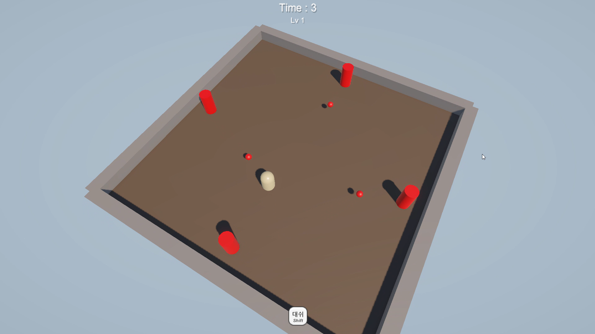

# Dodge

[▶ 플레이 영상 보기](https://youtu.be/ZnLeESy8oSo)

3D 사각형 맵에서 사방에서 날아오는 총알을 피하며 오래 버티는 게임입니다.

수업(3학년 2학기 컴퓨터게임) 실습으로 제공된 기본 프로젝트에 기능을 추가했습니다.

- 엔진: Unity 6 (6000.3.24f1), URP

## 조작

| 키 | 동작 |
| --- | --- |
| WASD / 방향키 | 이동 |
| Left Shift | 대쉬 |
| R | 게임 오버 후 재시작 |

## 기본 프로젝트 (수업 제공)

- 플레이어 이동
- 회전하는 발사대에서 플레이어를 향해 총알 발사
- 생존 시간과 최고 기록 저장

## 추가한 기능

- **대쉬** ([PlayerController.cs](Assets/Scripts/PlayerController.cs), [DashUI.cs](Assets/Scripts/DashUI.cs))
  짧은 시간 빠르게 이동하며, 대쉬 중에는 총알에 맞지 않습니다. 쿨타임은 화면 아이콘에 채워지는 형태로 표시되고, 다시 쓸 수 있게 되면 아이콘이 잠깐 커집니다.
- **시간 기반 레벨** ([GameManager.cs](Assets/Scripts/GameManager.cs))
  10초마다 Lv 1 → 2 → 3 → 4 → MAX로 오르며 총알 속도와 발사 간격이 달라집니다. MAX 이후에는 고정됩니다.
- **바닥 장판** ([Hazard.cs](Assets/Scripts/Hazard.cs), [HazardSpawner.cs](Assets/Scripts/HazardSpawner.cs))
  Lv 2부터 플레이어 위치에 장판이 깔리고, 안쪽이 다 차오르면 터집니다. 레벨이 오를수록 장판 크기가 커집니다.
- **피격 연출**
  총알에 맞으면 맞은 방향으로 튕겨 나가며 회전합니다.
- **스킨 / 배경 테마** ([CustomizeManager.cs](Assets/Scripts/CustomizeManager.cs))
  게임 오버 화면의 패널에서 캐릭터 색과 배경 색을 바꿀 수 있습니다.
- **효과음과 이펙트**
  발사음, 대쉬 잔상을 추가했습니다.
